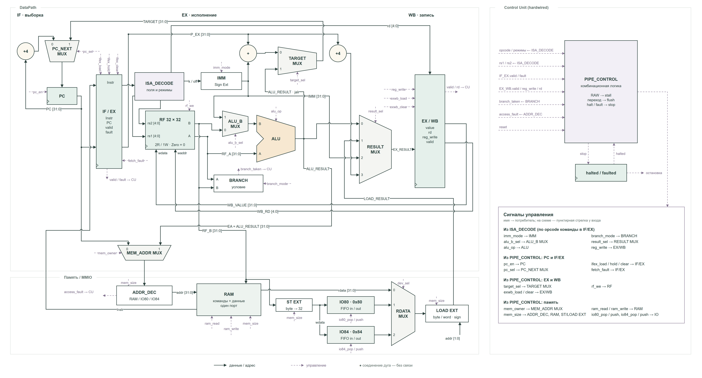

# Лабораторная работа №3 — RTL-схема процессора

Вариант `risc-iv-32-neumann-pipeline-3`: конвейер IF / EX / WB, общая однопортовая
память (фон Нейман), hardwired Control Unit, Memory-Mapped I/O (IO80 `0x80`, IO84 `0x84`).

- [schema.png](schema.png) / [schema.svg](schema.svg) — схема на одном листе
- [processor.drawio](processor.drawio) — редактируемый исходник (draw.io)

Обозначения: сплошная линия — данные / адрес, пунктир — управление;
● — соединение, дуга — пересечение без связи. Управляющие сигналы подписаны
у потребителя; полный перечень «сигнал → потребитель» — в блоке Control Unit.
